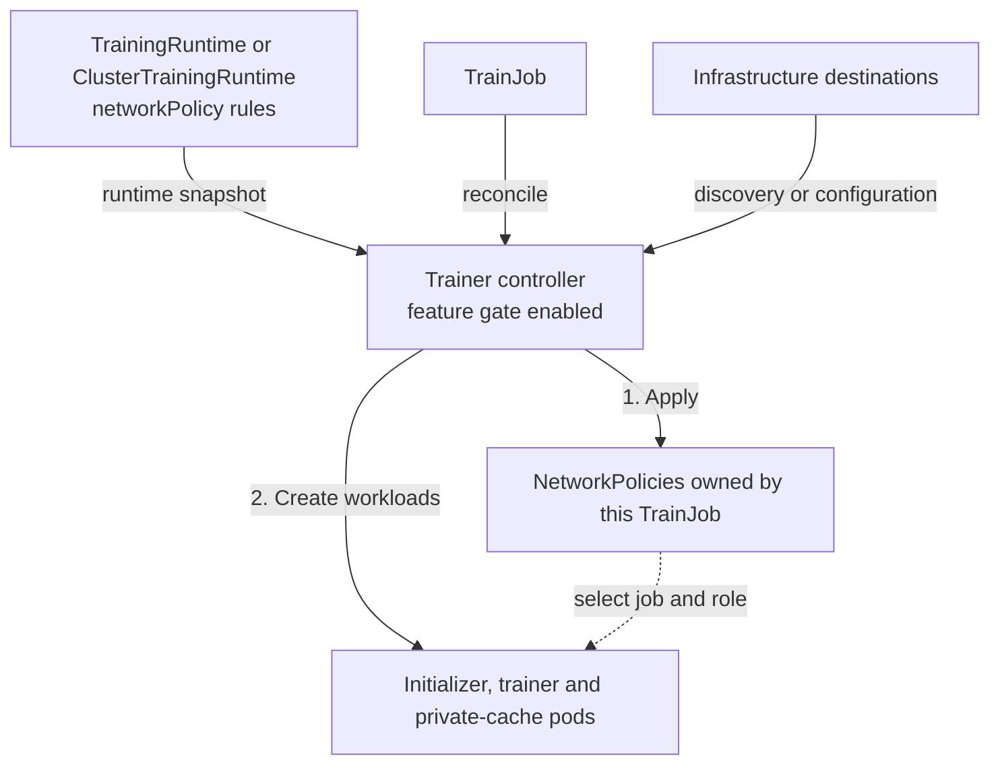

# KEP-3120: Network policies for training runtimes

**Working draft.** The API and behavior below are proposed, not supported Trainer APIs.

Author: Dan Ehrlich (@danvau7)

Tracking issue: [kubeflow/trainer#3120](https://github.com/kubeflow/trainer/issues/3120)

## Summary

Add optional network policy rules to `TrainingRuntimeSpec`, shared by
`TrainingRuntime` and `ClusterTrainingRuntime`. Trainer creates separate
NetworkPolicies for each TrainJob and its private cache, isolating jobs that
use the same runtime.

The proposed `TrainJobNetworkPolicy` feature gate starts disabled at alpha.
Job submitters continue selecting an approved runtime through TrainJob or the SDK.

## Motivation

Initializers may need model or dataset access that trainer pods do not need.
Different runtimes may require different storage destinations. Runtime authors
should describe those requirements without granting every training job the
same exceptions.

### Goals

- Define approved access per runtime, with optional initializer-specific rules.
- Maintain per-job isolation across pod replacement, retries and cleanup.
- Preserve required infrastructure access behind an opt-in feature gate.

### Non-Goals

Generic resource templates, PVC provisioning, Gateway management, authentication
and encryption are outside scope. TrainJob and `runtimePatches` will not expose
arbitrary policy overrides.

## Proposal

A runtime opts in with `spec.networkPolicy` when the feature gate is enabled.
An empty object requests baseline isolation; omitting the field preserves existing
behavior. Common rules apply to the job and its private cache. Optional rules
target named ReplicatedJobs, such as a dataset initializer.

Trainer renders policies from the TrainJob's runtime snapshot, applies them before
creating workloads, and repairs modified or deleted policies. Policy errors block
new workloads. Policy-object creation does not guarantee immediate CNI enforcement.



Each TrainJob receives its own policies and selectors, even when jobs reference
the same runtime. The diagram shows controller ordering, not a guarantee that
traffic is isolated before every pod starts.

### Risks and Mitigations

NetworkPolicies combine allowances: a narrower runtime rule cannot cancel another
policy's broad access. Runtime authors must be trusted, identity labels protected,
and tenant permissions constrained. Access to unprotected runtimes remains part
of that trust boundary. Namespace administrators and tenants allowed to spoof
labels or install bypass policies can defeat this isolation.

Require an enforcing CNI. Shared services may also need ingress policies from
their owner. Reject unsupported cases rather than silently leaving pods unprotected.

## Design Details

### Candidate API

Reuse native Kubernetes ingress and egress rule types. Trainer supplies policy
names, namespace, selectors, policy types and TrainJob ownership.

This proposed `TrainingRuntime.spec` fragment grants storage access only to a
separate initializer ReplicatedJob already defined in the runtime's JobSet template:

```yaml
spec:
  networkPolicy:
    ingress: []
    egress: []
    replicatedJobs:
      - name: dataset-initializer
        egress:
          - to:
              - namespaceSelector:
                  matchLabels:
                    kubernetes.io/metadata.name: storage
                podSelector:
                  matchLabels:
                    app: minio
            ports:
              - protocol: TCP
                port: 9000
```

The namespace and pod selectors must both match. Targeted rules add to common
allowances; they do not replace them. Kubernetes cannot assign different
NetworkPolicy access to containers sharing one pod.

Validate unique, existing ReplicatedJob names, rule semantics, CIDRs, ports,
protocols and list limits, using CEL where appropriate. Field names and whether
alpha includes role targeting remain open.

### Baseline and Infrastructure

Baseline allows same-job and private-cache communication, plus DNS, Kubernetes API
and Trainer status access when applicable.

- **DNS:** scoped pod/namespace selectors, with documented configuration for custom
  DNS and NodeLocal paths.
- **Status service:** prefer selectors with a named or configured target port.
- **Kubernetes API:** narrowly scoped automatic destination discovery is the candidate
  default. Allow Service/backend addresses and ports required by tested CNI behavior.
  Grant required destinations and ports rather than general outbound HTTPS.

Managed control planes such as EKS are not ordinary selectable workload pods.
Their API destinations may require address-based rules; private endpoints do not
become pod identities. Prefer selectors for ordinary in-cluster services.

EndpointSlice discovery refreshes allowances as relevant backend addresses or ports
change. Costs include cache memory, read permissions, reconciliations and
CNI-specific behavior. Scope new infrastructure watches to their namespaces,
filter relevant Services, enqueue only opted-in jobs, and generate deterministic rules.

Report discovery failures through actionable conditions or events. These errors
block new workloads with incomplete policies. Existing workloads keep their last
applied policies, which cannot guarantee continued connectivity.
Administrator-maintained API destinations are an alternative; choosing the alpha
default remains open. EKS compatibility and watch overhead require validation.

### Ownership and Lifecycle

- Require both the gate and runtime field. Reject new policy configuration while
  disabled rather than silently accepting unenforced settings. Preserve cleanup and
  status updates for existing objects.
- Create namespaced policies owned by the TrainJob, including for cluster-scoped
  runtimes. Never adopt foreign objects; use conditional writes and deletion
  preconditions to handle concurrent replacement.
- Snapshot runtime intent so later edits do not change running jobs. Do not retrofit
  snapshots lacking policy configuration. Infrastructure refreshes remain separate.
- Retain policies while completed or suspended jobs retain pods or private caches.
  Garbage-collect with the TrainJob; PVCs and shared caches keep separate ownership.
- Disabling the gate or downgrading must retain existing policies. Document explicit
  administrator cleanup, permissions and rollback behavior.
- Protect reserved labels, including through runtime patches. Operator-wide settings
  should cover infrastructure and feature enablement; runtime rules describe workload
  exceptions.

### Test Plan

Planned implementation checks:

Cross-job denial must be checked even for jobs using the same runtime, so shared
templates never imply shared workload network identity.

- **Unit:** omitted/empty fields, gate and rule validation, role targeting, cache
  selection, identity protection, deterministic discovery and errors.
- **Integration:** policy-before-workload ordering, scoped watches, ownership races,
  repair, snapshots, retries, suspension, completion, cleanup and rollback.
- **E2E:** enforcing-CNI checks across nodes and namespaces for same-job access,
  cross-job denial, initializer-only storage, DNS/API/status, recreated pods, native
  LWS caches and garbage collection. Cover selectorless destinations, endpoint
  rotation and supported IP families. Validate EKS before claiming support; existing
  connection behavior depends on the CNI.

### Graduation Criteria

Alpha requires an agreed API, disabled-by-default gate, schema/webhook and controller
coverage, enforcing-CNI tests, and documented trust, RBAC and rollback requirements.
Beta requires runtime-author feedback, a supported platform/CNI matrix, measured
overhead and settled discovery semantics. No release target is assigned.

## Drawbacks

Trainer gains policy-management responsibilities, infrastructure dependencies and
failure modes. Role targeting expands the API and requires reliable workload labels.

## Alternatives and Prior Art

- **Global exceptions:** simple, but grant every job the same additional access.
- **Manual policies or an external controller:** keep Trainer smaller but require
  coordination of per-job identity, ordering and cleanup.
- **Argo Workflows:** resource templates declaratively create Kubernetes resources
  with optional ownership for cleanup; PVC templates provide another precedent.
  This proposal adopts that pattern, not an Argo-standard NetworkPolicy API.
- **Kueue:** component policies protect Kueue itself, rather than isolating individual
  training jobs. AdmissionChecks could coordinate prerequisites, but Trainer should
  not require Kueue for basic isolation.
- **Static API destinations or CNI-specific identities:** reduce discovery at the
  cost of administrator maintenance or portability.

## Open Questions

1. Should alpha include ReplicatedJob targeting or start with common runtime rules?
2. Which infrastructure access is baseline, and should API discovery be automatic?
3. Which stable labels cover initializers, private caches, long names and recreation?
   What are the support boundaries for stateful workloads, host networking, meshes
   and secondary interfaces?

## References

- [Kubeflow KEP process](https://github.com/kubeflow/community/blob/master/proposals/README.md)
- [Trainer runtime guide](https://trainer.kubeflow.org/en/latest/operator-guides/runtime.html)
- [Kubernetes NetworkPolicy semantics](https://kubernetes.io/docs/concepts/services-networking/network-policies/)
- [Amazon EKS architecture](https://docs.aws.amazon.com/eks/latest/userguide/eks-architecture.html)
- [Argo resource templates](https://argo-workflows.readthedocs.io/en/latest/walk-through/kubernetes-resources/)
- [Argo PVC templates](https://argo-workflows.readthedocs.io/en/latest/walk-through/volumes/)
- [Kueue AdmissionChecks](https://kueue.sigs.k8s.io/docs/concepts/admission_check/)
- [Kueue component policies](https://github.com/kubernetes-sigs/kueue/blob/e1c47e65421b2688c808dfdb9e10c625c7df4571/site/content/en/docs/tasks/manage/productization/network_policies.md)
